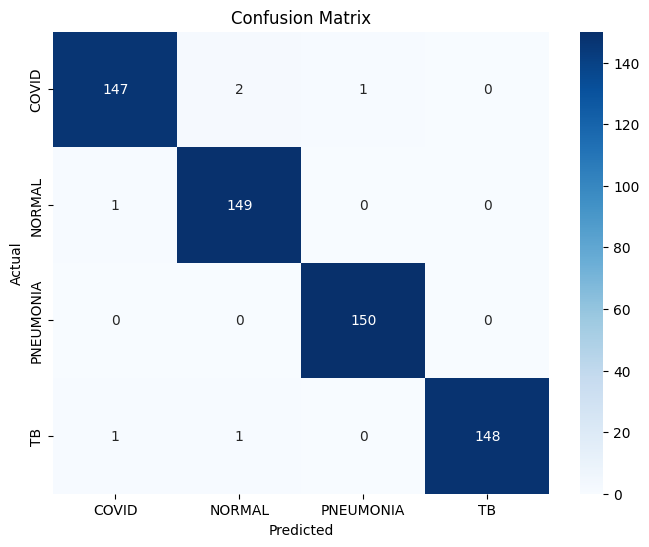
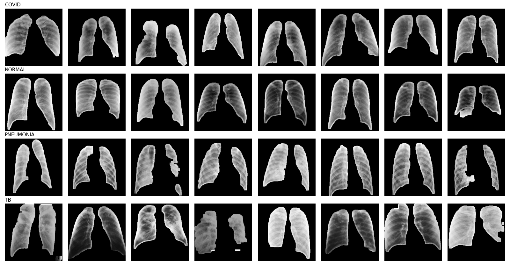
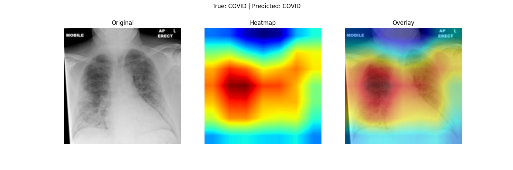
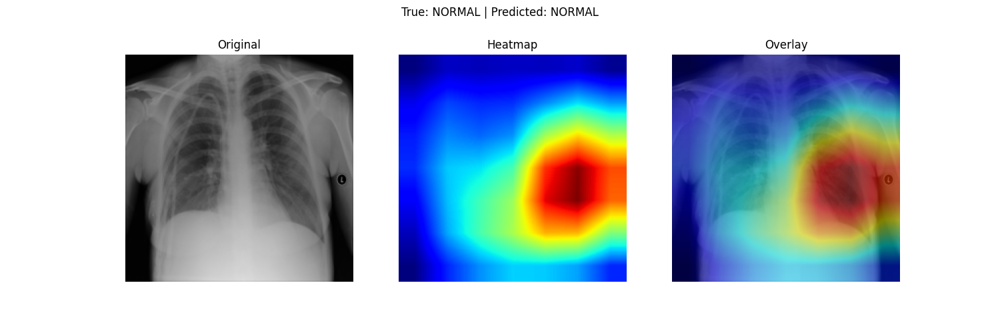
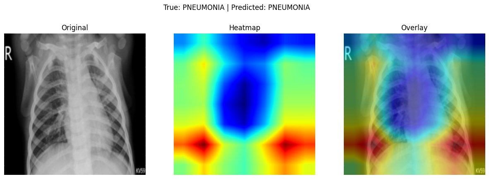
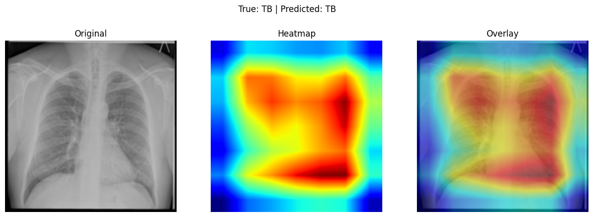
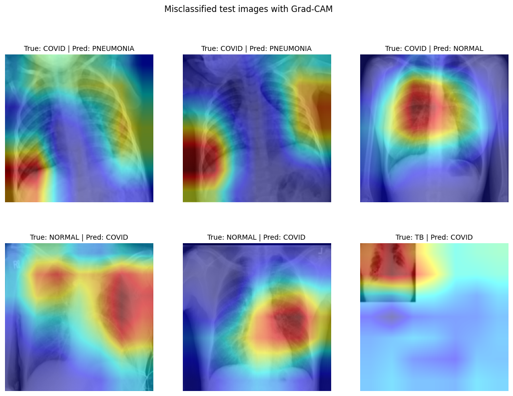

# Chest X-Ray Classification with Grad-CAM

A CNN-based classifier for chest X-rays, distinguishing between COVID-19, Normal, Pneumonia, and Tuberculosis, with Grad-CAM visualizations showing where the model focuses when making each prediction.

## Overview

This project uses transfer learning with a pretrained ResNet18 to classify chest X-ray images into four categories. Given that medical imaging datasets are often limited in size, transfer learning was chosen over training from scratch to make better use of the available 2,000 training images.

Beyond classification, the project implements Grad-CAM (Gradient-weighted Class Activation Mapping) to visualize which regions of an X-ray the model relies on for its predictions — an important step toward making the model's decisions interpretable rather than a black box.

## Dataset

## Dataset

A four-class chest X-ray collection (COVID-19, Normal, Pneumonia, Tuberculosis) that appears to be compiled from several public sources. All 650 Pneumonia images were matched to images in the Kermany et al. dataset (children aged one to five, Guangzhou Women and Children's Medical Center, CC BY 4.0), resized to 299 x 299. The Normal, COVID-19 and TB images did not match Kermany, and their sources have not been confirmed.

- Classes: COVID-19, Normal, Pneumonia, Tuberculosis
- Training set: 2,000 images (500 per class), 1,936 after removing duplicates. About 15% of them are held out as a validation set, stratified by class.
- Test set: 600 images (150 per class), 566 after removing duplicates, used once per run at the end.
- Image size is 299 x 299 for COVID-19 and Pneumonia and 512 x 512 for Normal and TB, and the classes differ clearly in how the images look (see Limitations).

Note: the same images are also used in an ongoing M.Eng. research project comparing radiomics and foundation model performance across datasets and modalities. This repository is a distinct piece of work, a CNN classification and explainability pipeline, built independently of that research.

## Architecture


## Results

**Protocol.** Near-duplicate images were removed first (see Shortcut audit): 64 from the training set and 34 from the test set, leaving a 566-image test set. 15% of the remaining training images were held out as a validation set, used to choose the best epoch. A ResNet18 pretrained on ImageNet was fine-tuned for 10 epochs (Adam, learning rate 0.0001, batch size 32) with three seeds. The test set was used once per run, at the end.

| Input | Test accuracy (mean of 3 seeds) | Range | COVID-19 recall (mean) |
|---|---|---|---|
| Original images | 98.2% | 97.9% to 98.4% | 94.1% |
| Lung region only | 94.2% | 94.2% to 94.4% | 91.3% |

With 566 test images, the 95% confidence interval for a single accuracy figure is about one point either way. COVID-19 is the weakest class.

Per-class detail from one earlier run (seed 42, evaluated on the full 600-image test set before de-duplication):

| Class | Precision | Recall | F1-score |
|---|---|---|---|
| COVID | 0.96 | 0.96 | 0.96 |
| Normal | 0.99 | 0.97 | 0.98 |
| Pneumonia | 0.98 | 1.00 | 0.99 |
| TB | 0.99 | 0.98 | 0.98 |



The confusion matrix is from the same single run.

An earlier version of this project chose the best epoch using the test set and reported 99%. That number was optimistic, because the test data had influenced the choice. This version uses a separate validation set.

## Shortcut audit

The classes in this dataset look different from each other in ways unrelated to disease (see Limitations), so high accuracy could come partly from those differences. Three checks were run.

**1. Baseline without anatomy.** A logistic regression using only image size, average brightness, contrast and the share of black and white pixels reaches 81% cross-validated accuracy on the training images (chance is 25%).

**2. Duplicate check.** All 650 Pneumonia images are resized copies of Kermany images (see Dataset). Separately, 34 test images (31 of the 150 COVID-19 images) were near-exact copies of training images, and 64 training images duplicated other training images (thumbnail correlation above 0.98). They were removed. For the same models, accuracy was 98.22% on the full test set and 98.17% after removal, so the duplicates did not inflate the result.

**3. Lung masking.** A U-Net trained for lung segmentation (see the lung-segmentation-unet repository) was used to black out everything outside the lungs. This removes borders, text markers, timestamps, white boxes and the image background. The classifier was then retrained with the same settings, with three seeds per condition, on the de-duplicated data.

| Input | Test accuracy (mean of 3 runs) | Range |
|---|---|---|
| Original images | 98.2% | 97.9% to 98.4% |
| Lung region only | 94.2% | 94.2% to 94.4% |

Removing everything outside the lungs lowers accuracy by about 3.9 points, and the ranges do not overlap. This indicates that part of the accuracy relies on information outside the lungs. It is an upper estimate of that effect, because the segmentation model is imperfect, especially on the Pneumonia images (children's X-rays and dense lungs), and cut away some lung tissue as well.

Accuracy stays well above chance with only the lungs visible, so there is also signal inside the lungs. But the lung region still differs between classes in other ways, such as lung size and framing, image processing and patient age. Even this result is therefore not evidence that the model detects disease. Testing on images from other hospitals would be needed.

The code for these checks is in `notebooks/shortcut_audit.ipynb`.



## Grad-CAM Visualizations

Grad-CAM shows which parts of the image the model relied on for a prediction. The maps are coarse (about 7 x 7 cells stretched over the image), so they show where the model looked, not where disease is.






For the COVID, Normal and TB examples, the strongest activation falls mostly inside the chest. For the Pneumonia example, it concentrates in the lower corners and along the sides, partly outside the lungs, so this example does not show the model looking at lung tissue. One example per class is not enough to conclude whether the model uses image borders or markers.

### Misclassified cases



Six of the 13 test errors are shown (every second one). All six involve the COVID class. Two COVID images predicted as Pneumonia appear tightly cropped, with heat at the image edge. One TB image predicted as COVID is a small X-ray on a mostly blank canvas, which looks like a data problem. The maps do not show a single clear cause for the errors.

## Installation

```bash
pip install -r requirements.txt
```

## Running tests

```bash
pytest tests/
```
## Limitations

- **Class-linked image differences (shortcut risk).** The classes come from different sources. All Pneumonia images are children's X-rays from the Kermany dataset, resized to 299 x 299, while the other classes look like adults. Image size depends on the class (299 x 299 for COVID-19 and Pneumonia, 512 x 512 for Normal and TB). In a random sample of eight images per class, the Pneumonia images carry a large "R" marker and timestamps, six of the eight TB images have white rectangles over part of the image, and several COVID-19 images carry text labels. A logistic regression using only image size, average brightness, contrast and the share of black and white pixels reaches 81% cross-validated accuracy on the training images (chance is 25%). The CNN may therefore use these cues instead of, or alongside, disease. The 98.2% test accuracy comes from the same sources, so it does not show how the model would perform on X-rays from a new hospital or scanner, and it should not be read as evidence that the model detects disease.
- **Duplicates.** Near-duplicates were found between the training and test sets (34 test images, 31 of them COVID-19) and inside the training set (64 images). They were removed before the final runs, and removal changed test accuracy by less than 0.1 point. Duplicates were detected with 32 x 32 thumbnails, so copies that were cropped or flipped could be missed.
- **Small, single-split evaluation.** Three seeds were run on one train and test split. With 566 test images, the 95% confidence interval for accuracy is about one point either way. The model was trained on fewer than 2,000 images and was not tested on any outside data.
- **COVID-19 is the weakest class** (recall about 94%).
- **Grad-CAM is qualitative and coarse.** It shows where the model looked, not where disease is. For the same X-ray, two training runs with similar accuracy highlighted different lungs, and in the Pneumonia example the heat was mostly at the image edges.
- **Overfitting.** Training accuracy reaches nearly 100% within a few epochs. The best epoch is chosen on a held-out validation set, and the test set is used only once per run, at the end.

This project is for education and research only. It is not designed for clinical diagnosis or deployment in a clinical setting.

## License

MIT
